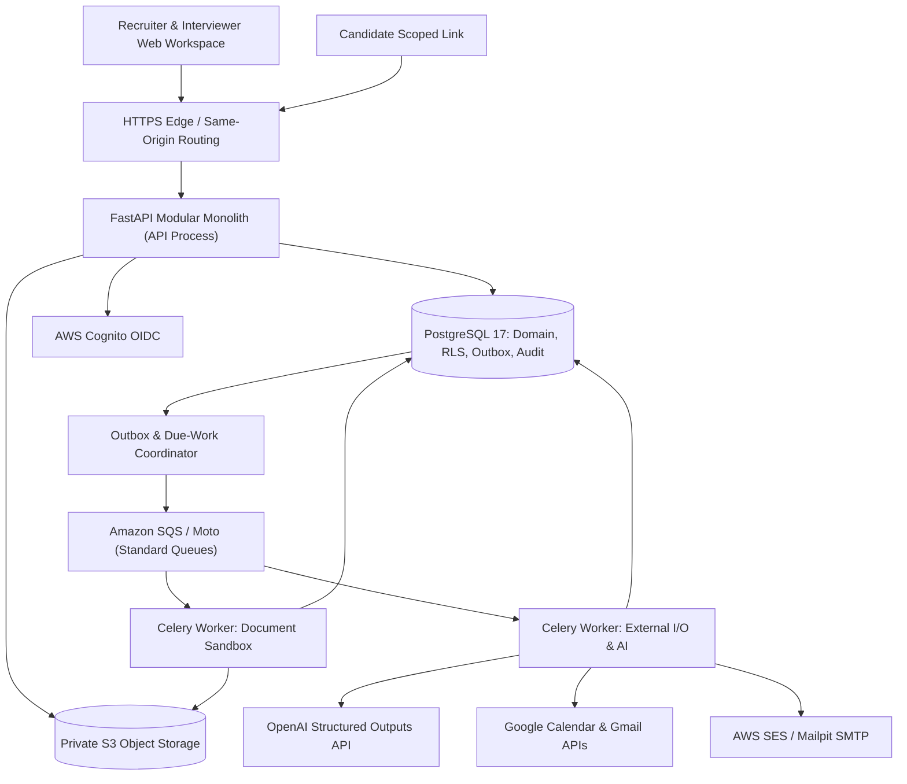
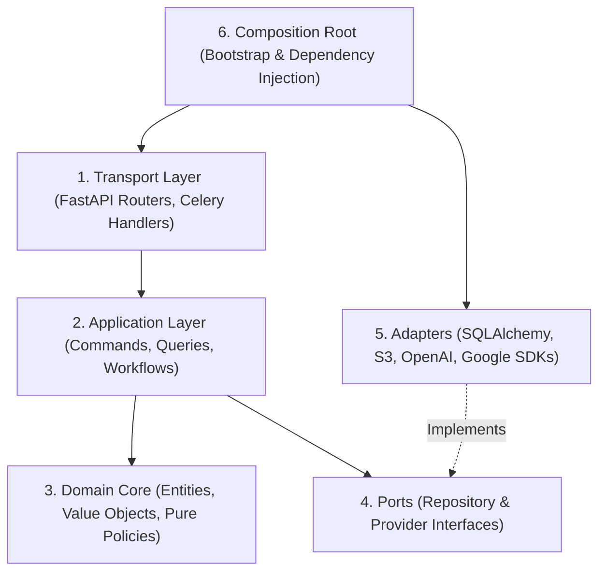
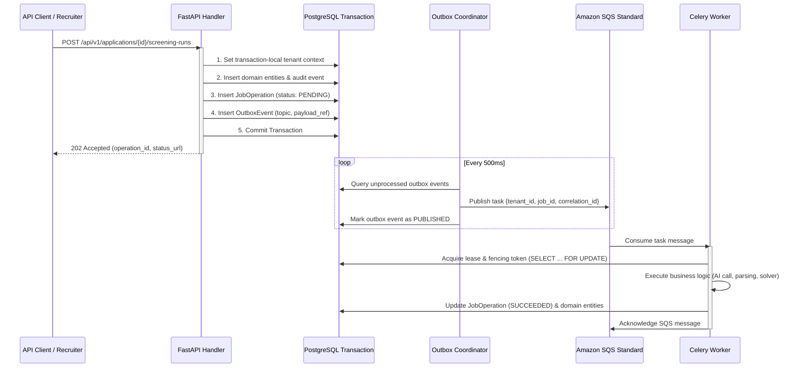
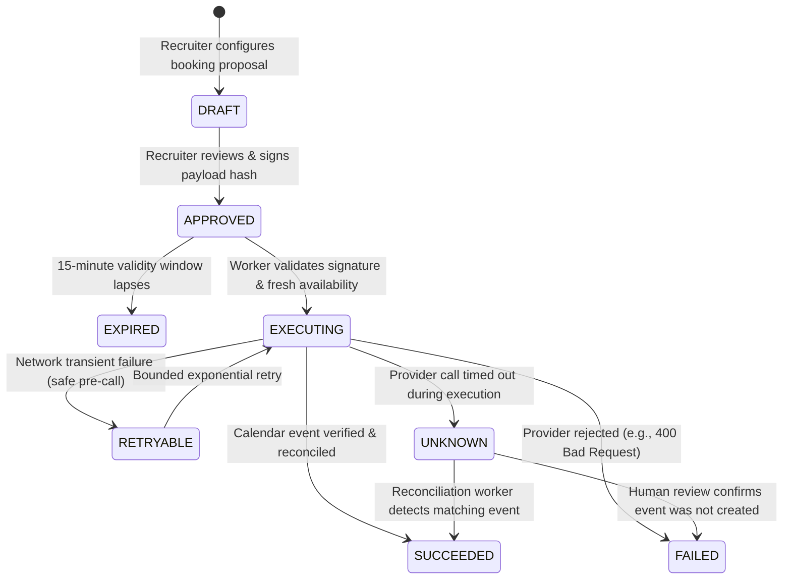

# Talvora System Architecture & Design Contract

## 1. Architectural Style & Boundaries

Talvora is built as a **Modular Monolith** deployed as a single versioned release artifact across specialized runtime process profiles:
1. **API Process (`web`):** Handles synchronous HTTP requests from the staff workspace and scoped candidate capability links. Operates under strict latency budgets; executes zero blocking OCR, document parsing, or multi-second external AI/calendar calls.
2. **Worker Processes (`celery`):**
   - **Document Worker:** Runs with restricted OS permissions, memory/CPU bounds, and no external calendar/email write access. Handles PDF/DOCX parsing, bounded OCR, and virus scan coordination.
   - **I/O Worker:** Handles external provider communications: OpenAI structured API calls, Google Calendar queries/mutations, and Gmail/SES transactional mail.
3. **Outbox Coordinator Process (`coordinator`):** Runs lightweight, periodic database sweeps over the transactional outbox, due retries, expired worker leases, and reminder schedules.



---

## 2. Ports and Adapters (Hexagonal) Architecture

To preserve clean separation of concerns and testability, Talvora enforces strict unidirectional layer dependency rules:



### Dependency Rules:
- **Domain Layer (`talvora.modules.*.domain`):** Pure Python business models, value objects, domain events, and state transition logic. **Imports no external frameworks:** zero FastAPI, zero SQLAlchemy, zero Celery, zero Pydantic, zero HTTP clients, and zero cloud SDKs.
- **Application Layer (`talvora.modules.*.application`):** Use case handlers, transactional boundaries, authorization contracts, and orchestrators. Coordinates domain entities and calls Ports.
- **Ports (`talvora.modules.*.ports` or `talvora.shared.application`):** Abstract interfaces (Python `typing.Protocol` or `abc.ABC`) defining repository contracts and external services.
- **Adapters (`talvora.modules.*.infrastructure`):** Concrete implementations of ports utilizing SQLAlchemy 2.0 ORM, Boto3 S3 clients, Google API client libraries, and OpenAI SDKs.
- **Transport (`talvora.modules.*.api`):** FastAPI endpoints, Pydantic request/response DTOs, OpenAPI annotations, and HTTP problem formatting.

---

## 3. Durable Outbox & Reliable Task Execution

To guarantee that database updates and asynchronous background jobs remain atomic without distributed transactions (2PC), Talvora implements the **Transactional Outbox Pattern**:



### Outbox & Queue Invariants:
1. **Zero Sensitive Payload in Messages:** SQS messages contain strictly minimal routing references: `{ "tenant_id": "<uuid>", "job_id": "<uuid>", "operation_id": "<uuid>", "correlation_id": "<uuid>" }`. Resumes, provider tokens, and candidate details **never** enter queue messages.
2. **At-Least-Once Delivery & Idempotency:** SQS Standard is at-least-once. Workers must acquire an atomic lease and fencing token on the `job_operation` row before processing. A worker with an expired fencing token cannot commit changes.
3. **PostgreSQL-Managed Retries:** Retries and exponential backoff are managed directly in the `job_operation` table (`retry_count`, `next_attempt_at`, `max_retries = 5`), not via long Celery message countdowns.
4. **Visibility Timeout Headroom:** SQS queue visibility timeout is configured to 900 seconds, well above the 600-second hard worker execution cutoff.

---

## 4. Calendar Booking Saga & External Side Effect Reconciliation

External actions (dispatching emails via Gmail, booking Google Calendar events) cannot participate in two-phase commit transactions. Talvora governs side effects through an explicit state machine:



### Saga Invariants:
- **Approval Integrity:** An approval binds `tenant_id`, `actor_id`, `payload_sha256`, `scheduled_start_utc`, `scheduled_end_utc`, and `expires_at`. Any modification to attendees or timings invalidates the approval.
- **Deterministic Provider ID:** Google Calendar event IDs are derived deterministically: `cal_evt_{external_action_uuid}`. If an API call times out, the reconciliation worker queries this deterministic ID to detect if the event was created, preventing duplicate event spam.
- **Range Exclusion Locking:** Internal interviewer intervals are locked in PostgreSQL using `tstzrange` and `btree_gist` exclusion constraints. Two simultaneous booking attempts for the same interviewer will fail at the database constraint level before reaching Google.

---

## 5. Concrete Local Stack & Environment Profiles

In Phase P01, Talvora establishes a 100% reproducible local development stack using Docker Compose:

| Component | Local Development Container | Staging / Production Service |
| --- | --- | --- |
| **Relational DB** | PostgreSQL 17 (`postgres:17-alpine`) | AWS RDS PostgreSQL 17 (Multi-AZ) |
| **Object Storage**| Moto S3 (`motoserver/moto:latest`) | Private Amazon S3 (KMS Encrypted) |
| **Message Broker**| Moto SQS (`motoserver/moto:latest`) | Amazon SQS Standard + DLQ |
| **Mail Interceptor**| Mailpit (`axllent/mailpit:latest`) | Amazon SES / Delegated Gmail API |
| **Antivirus** | ClamAV Daemon (`clamav/clamav:stable_base`) | ClamAV Daemon sidecar container |
| **Identity / OIDC**| Mock OIDC Provider / Keycloak | AWS Cognito User Pool with Hosted UI |

### Development vs Production Adapters:
- **Real Functionality:** PostgreSQL, Alembic migrations, RLS policies, PDF/DOCX extractors, interval arithmetic, and deterministic screening algorithms run real code in all environments.
- **Test Doubles / Emulators:** Moto simulates AWS S3 and SQS locally; Mailpit captures platform system emails; ClamAV runs a lightweight local scanning daemon.
- **Production-Disabled Safety:** Test doubles and mock adapters are strictly forbidden from running in production through environment guards (`TALVORA_ENVIRONMENT != "production"`).

---

## 6. Named Engineering Commands (Baseline for P01)

The following canonical CLI commands are established in P00 and will be scaffolded in P01:

```bash
# Environment & Services
talvora dev up              # Start PostgreSQL, Moto, Mailpit, ClamAV via Docker Compose
talvora dev down            # Stop and preserve local development services
talvora dev reset           # Clean local databases and rebuild containers

# Database & Migrations
talvora db migrate          # Run pending Alembic migrations
talvora db check-drift      # Verify no uncommitted ORM vs database schema drift
talvora db test-rls         # Execute dedicated RLS tenant isolation test suite

# Code Quality & Verification
talvora lint                # Run Ruff format check and linter
talvora typecheck           # Run mypy in strict mode across src/ and tests/
talvora test                # Run full pytest test suite (unit + integration + contract)
talvora test:unit           # Run fast domain unit tests only
talvora test:integration    # Run PostgreSQL + Moto integration tests

# Application Execution
talvora run api             # Start FastAPI development server (uvicorn)
talvora run worker          # Start Celery worker process
talvora run coordinator     # Start transactional outbox sweeper process
```
