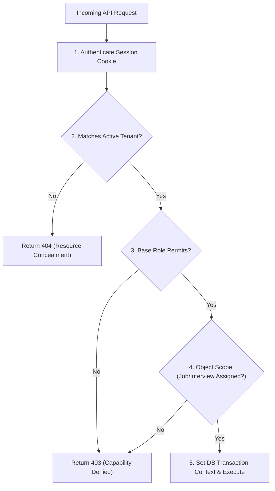

# Talvora Personas & Permission Model

## 1. Principles of Authorization

Authorization in Talvora is governed by four core architectural rules:
1. **Multi-Tenancy is First-Class:** Every staff user operates within an active Organization Membership. All permissions are evaluated strictly within the tenant scope.
2. **Object-Level Boundaries:** A broad role does not confer universal access. Vacancies and candidate applications require explicit Job Assignments.
3. **Defense in Depth:** The UI adapts to permissions for user experience, but authorization is enforced unconditionally at the server and database layers (PostgreSQL Row-Level Security).
4. **Information Leakage Prevention:** Unauthorized requests across different tenants return `404 Not Found` rather than `403 Forbidden` to prevent tenant enumeration or confirming the existence of competitor records. Same-tenant requests lacking capability return `403 Forbidden`.

---

## 2. Personas and Base Membership Roles

Every staff user holds an authenticated Identity (`User`) linked to an `Organization` through an active `Membership`. In Release 1, each membership holds exactly one base role:

| Persona / Role | Description & Operational Scope |
| --- | --- |
| **OWNER** | Highest organizational authority. Manages organization policy, billing, integrations, and retains ownership rights. Can transfer ownership (subject to step-up authentication). |
| **ADMIN** | Workspace administrator. Manages user invitations, team assignments, system settings, and privacy compliance requests. Does not possess hiring authority across all jobs by default. |
| **RECRUITER** | Operational recruitment lead. Creates vacancies, reviews intake batches, verifies candidate contacts, overrides screening, and approves interview scheduling and external communications. |
| **HIRING_MANAGER** | Departmental hiring leader. Co-designs job requirements, reviews qualified applications on assigned jobs, and reviews candidate packs and feedback. |
| **INTERVIEWER** | Panel participant. Accesses assigned interview packs (with source evidence excerpts), submits private evaluation feedback, and manages personal calendar availability. |
| **CANDIDATE** | External party. Accesses a dedicated, short-lived, cryptographically scoped candidate session via an unguessable capability link. Can submit availability and view booking status for a single interview request. |

---

## 3. Capability Matrix

The table below defines the authoritative capability matrix for Talvora Release 1:

| Capability / Action | OWNER | ADMIN | RECRUITER | HIRING_MANAGER | INTERVIEWER | Candidate Link Holder |
| --- | :---: | :---: | :---: | :---: | :---: | :---: |
| **Manage Org Policy & Ownership Transfer** | Yes | No | No | No | No | No |
| **Manage Members, Teams & Integrations** | Yes | Yes | No | No | No | No |
| **Create New Job Vacancy** | Yes | If Assigned | Yes | Yes | No | No |
| **Read Applications & Resumes** | Assigned | Assigned | Assigned | Assigned | Excerpts Only (Assigned Pack) | Own booking only |
| **Edit Requirements & Publish Versions** | Assigned | If Hiring Cap | Assigned | Assigned | No | No |
| **Stage Transitions (Advance / Reject)** | Assigned | If Hiring Cap | Assigned | Assigned | No | No |
| **Override Screening Verdicts** | Assigned | If Hiring Cap | Assigned | Assigned | No | No |
| **Approve External Scheduling (Email/Cal)** | Assigned | If Sched Cap | Assigned | Assigned | No | No |
| **Connect Personal Google Account** | Yes | Yes | Yes | Yes | Yes (Free/Busy scope) | No |
| **Read Another Member's OAuth Tokens** | **NEVER** | **NEVER** | **NEVER** | **NEVER** | **NEVER** | **NEVER** |
| **Read Peer Interview Feedback** | Assigned (Blind rule) | Assigned | Assigned | Assigned | Own draft; Peers only after own submit | **NEVER** |
| **Submit Interview Feedback** | If Participant | If Participant | If Participant | If Participant | If Participant | No |
| **Execute Privacy Purge / Retention Holds** | Yes | Yes | Request Only | Request Only | No | Request via support |
| **Submit Availability & Request Reschedule** | Via workflow | Via workflow | Via workflow | Via workflow | Own calendar | Scoped token for 1 interview |

---

## 4. Evaluation Architecture

The backend permission service evaluates authorization via a deterministic tuple:

$$\text{Decision} = \text{Evaluate}(P, M, C, R_{org}, J_{assign}, I_{part}, S_{res})$$

Where:
- $P$: Authenticated Principal (User ID).
- $M$: Active Organization Membership (Role, Status = `ACTIVE`).
- $C$: Required Capability for the requested API operation.
- $R_{org}$: Organization ID of the target resource.
- $J_{assign}$: Object-level Job Assignment (e.g., `RECRUITER`, `HIRING_MANAGER`, `COLLABORATOR`).
- $I_{part}$: Interview Participation (assigned panelist on specific interview revision).
- $S_{res}$: Resource State (e.g., draft vs published, application stage, feedback submission status).

### Context Enforcement Flow

---

## 5. Specialized Security Governance Rules

### 5.1 The Blind Feedback Isolation Invariant
- Interviewers must evaluate candidates independently without anchoring on or copying peer evaluations.
- When an interviewer requests `GET /interviews/{id}/feedback`, the system filters out all peer feedback records unless the requesting interviewer has already submitted an immutable `FeedbackRevision` (`status = 'SUBMITTED'`).
- Bypassing this filter via prefetching, serialization leaks, or export downloads is strictly prevented by test assertions.

### 5.2 Ownership Transfer Protocol
- Transferring Organization ownership requires:
  1. The actor must be the current active `OWNER`.
  2. Step-up re-authentication (fresh credential prompt).
  3. The target recipient must hold an active membership in the same organization.
  4. An atomic database transaction demotes the caller to `ADMIN` and promotes the recipient to `OWNER`, guaranteeing that every organization maintains exactly one primary owner.

### 5.3 Immediate Offboarding Revocation
- When an organization administrator offboards a member:
  1. Membership status transitions to `REVOKED`.
  2. All active user sessions are invalidated immediately in PostgreSQL.
  3. Any pending external action approvals signed by the offboarded member are revoked (`state = 'EXPIRED'`).
  4. Connected OAuth integration tokens are severed.
  5. Historic authorship of past stage events, comments, and screening runs is preserved for audit fidelity.

### 5.4 Exclusion of "Super-Admin" Backdoors
- Global platform engineers and operators operate under dedicated database roles with zero direct access to candidate personal data.
- System metrics and health endpoints (`/health/live`, `/health/ready`) are unauthenticated but return zero domain or tenant metadata.
- Emergency customer support access requires a time-bounded, cryptographically signed, and audited session ticket approved by the customer organization owner. Universal "god-mode" administrative bypasses are explicitly forbidden.
