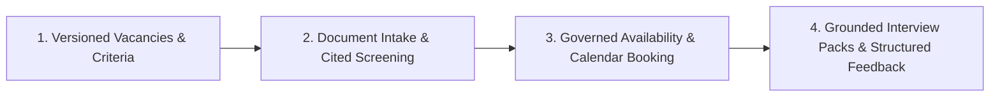

# Talvora Product Vision

**Intelligent Talent Operations Workspace**

## 1. Executive Summary

Talvora is an enterprise talent operations workspace that transforms unstructured recruitment inputs—resumes, job specifications, interviewer calendars, and candidate evaluations—into inspectable, evidence-backed work products. 

Talvora's primary value is eliminating coordination friction and cognitive fatigue for recruiting teams while enforcing rigor, compliance, and provenance across every hiring touchpoint.

**Core Mandate:** Talvora is **not** an autonomous hiring authority. It is an intelligent co-pilot and operational engine that prepares structured evidence for human decision-makers.

---

## 2. The Three Product Invariants

Every subsystem, database schema, API contract, background task, and user interface in Talvora must strictly adhere to three non-negotiable architectural invariants:

### Invariant 1: Evidence Before Assertion
- Every candidate-specific factual statement must trace directly to an immutable resume version and verifiable source location (document ID, segment ID, fragment ID, and exact Unicode code-point character offsets).
- Incomplete records, date conflicts, and gaps in candidate history must remain explicitly visible as `UNKNOWN` or `CONFLICT`.
- Human additions and corrections are tracked as distinct revisions marked `HUMAN_ASSERTION_UNVERIFIED`.
- Machine models and parsers are strictly prohibited from hallucinating missing dates, inferring unstated degrees, or guessing equivalence.

### Invariant 2: Authority Before Action
- All consequential hiring actions—moving candidate stages, approving vacancy requirements, modifying screening verdicts, issuing candidate invitations, and booking calendar slots—require explicit human authorization by an authorized principal holding verified capabilities.
- Large Language Models (LLMs) operate strictly in an isolated, read-only analytical capacity. LLMs possess **zero write tools**, cannot transition application stages, cannot generate public URLs, and cannot trigger external side effects.
- External side effects (dispatching emails via Gmail, inserting Google Calendar events) are governed by an immutable approval saga with time-bounded, cryptographic payload integrity.

### Invariant 3: Recoverable Operations
- All background workloads, external API calls, AI extractions, and multi-step workflows must be durable, idempotent, and inspectable.
- Work is admitted asynchronously via a PostgreSQL transactional outbox and durable job ledger before external dispatch.
- Network timeouts, worker crashes, and third-party API throttling must enter defined recovery states (`RETRYABLE`, `UNKNOWN`, `RECONCILIATION_REQUIRED`) rather than fabricating success or causing phantom calendar reservations.

---

## 3. The Four Core Product Capabilities

Talvora demonstrates a unified vertical journey spanning four integrated capabilities:

### Capability 1: Versioned Vacancies & Requirement Frameworks
- Job vacancies progress through explicit lifecycle states (`DRAFT` → `OPEN` ↔ `PAUSED` → `CLOSED`).
- Requirements are published into immutable, versioned requirement sets.
- Supported criteria types are strictly typed and deterministic:
  - `SKILL_PRESENT` (normalized skill presence)
  - `MIN_EXPERIENCE_MONTHS` (calendar-aware interval arithmetic)
  - `EDUCATION_LEVEL` (explicit degree hierarchy)
  - `CERTIFICATION_PRESENT` (validity and active status)
  - `MANUAL_REQUIREMENT` (explicit human check)
- No unversioned in-place requirement edits. Changing criteria publishes a new requirement version; previous evaluations retain their historic baseline.

### Capability 2: Quarantined Document Intake, Provenance & Cited Screening
- High-throughput batch upload (up to 100 files, 10 MiB per file) with streaming quarantine, malware scanning (ClamAV), container integrity checks, and bounded text/OCR extraction.
- Generation of immutable source segments and canonical character offsets for PDF (page-aware) and DOCX (paragraph/table-cell path aware).
- Extraction of structured candidate facts citing exact evidence fragments.
- Deterministic screening engine evaluating facts against published requirement rules, yielding tri-state verdicts:
  - `PASS`: Proven by cited evidence.
  - `FAIL`: Explicit, verified contradiction against complete history.
  - `NEEDS_REVIEW`: Missing facts, partial history, preference skills absent, or manual verification needed.
- Recruiter overrides record author, timestamp, and audit rationale without mutating the machine evaluation run.

### Capability 3: Governed Scheduling, Availability & Calendar Booking Saga
- Transition to `INTERVIEW_APPROVED` by an authorized recruiter triggers availability coordination.
- Scoped candidate link with time-bounded, cryptographically random capability token (HMAC-SHA256, no mutation on GET).
- Direct candidate submission of availability intervals in their native IANA timezone.
- Deterministic interval solver intersecting candidate availability, interviewer working hours, Google Calendar free/busy feeds, internal reservations, and buffer rules.
- Recruiter approval of exact slot proposals, organizer, attendees, and message content.
- Calendar booking saga using PostgreSQL range exclusion (`tstzrange` + `btree_gist`), fencing tokens, Google Calendar event insertion with deterministic IDs, and post-timeout reconciliation.

### Capability 4: Evidence-Grounded Interview Packs & Blind Feedback
- Stage- and duration-aware interview pack generation bound to published requirement and profile snapshots.
- All candidate-specific question premises cite source evidence; hypothetical scenarios are explicitly labeled.
- Anti-bias safeguards: no protected demographic traits, health, or family circumstances in generated questions.
- Anchored behavioral rubrics (1–4 scale plus `NOT_ASSESSED`).
- Independent interviewer feedback collection with peer-blind isolation (evaluations remain hidden from peers until own submission is committed).
- Tamper-evident export generation (editable DOCX and print-ready PDF via WeasyPrint) with restricted local assets and private download tokens.

---

## 4. Forbidden Anti-Patterns (Explicit Non-Goals)

To prevent compliance violations, bias propagation, and operational failure, the following features are **strictly prohibited** from Talvora:

1. **No Opaque Candidate Scoring or Percentage Match:** No single "match score" (e.g., "87% fit"). Criteria must be evaluated individually and transparently.
2. **No Global Ranking or Leaderboards:** Candidates are not sorted or ranked against each other by AI algorithms.
3. **No Inferred Soft Skills or Psychological Profiling:** No inference of personality types, emotional stability, culture fit, or enthusiasm.
4. **No Biometric, Video, or Voice Analysis:** No facial expression tracking, eye gaze monitoring, or speech acoustics processing.
5. **No Autonomous AI Pipeline Decisions:** No automated candidate rejection emails, shortlisting, or stage advancing driven directly by an LLM.
6. **No Silent Data Fallbacks or Fuzzy Equivalences:** Degrees and certifications are never assumed equivalent without explicit configuration in published equivalence rules.
7. **No Direct Model Access to Write Tools or External APIs:** Models never receive database connection strings, calendar write tools, or email dispatch interfaces.
